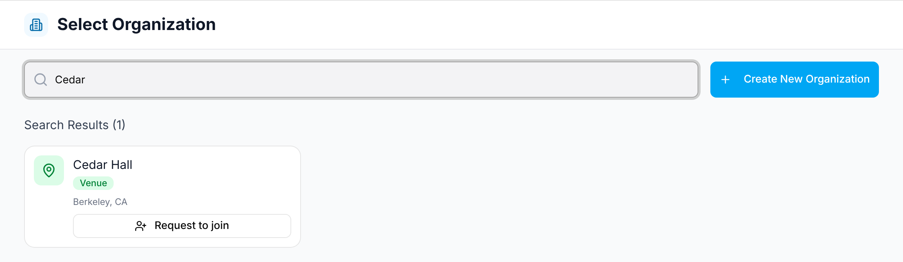
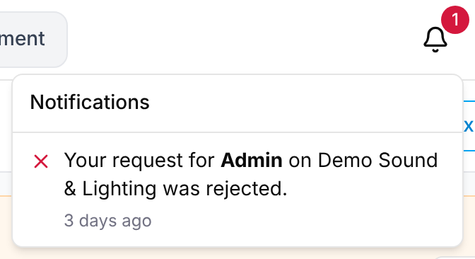

Everything in GigWrangler belongs to an **organization**. A new account isn't in
one yet, so your first move is one of four paths.

## 1. Create a new organization

From **Select Organization**, choose **Create New Organization** (or
**Create Your First Organization** if you aren't in any yet).

- You can search for your business on Google to auto-fill its details, or choose
  **Skip search and enter details manually**.
- Required: a **name** and at least one **Organization Role** (Production Company,
  Sound Company, Lighting Company, Staging Company, Rental Company, Venue, Act,
  Agency).
- Optional: **Phone Number**, **Website URL**, **Allowed Email Domains** (people
  whose email matches can join as Staff without asking), a **Description**, and an
  address.
- Choose **Create and Join**. You become the organization's **Admin**.

GigWrangler limits how often you can create organizations and look businesses up
on Google. Past a limit, creating one says "… Try again later.", and business search
shows **Business search is paused**: type the details in by hand instead.

:::note[Create without Joining]
There's also a **Create without Joining** option, for registering a partner
organization — a venue or vendor you work with but aren't part of. That
organization is then **unclaimed** (see below) until someone takes it over.
:::

## 2. Ask to join an existing organization

If the organization already exists (for example, a venue that was added as a gig
participant), you don't create a duplicate. You ask to join the real one.

1. On **Select Organization**, search for the organization by name in
   **Search all organizations...**. (Once you're in an organization, the avatar
   menu's **Switch Organization** takes you back to this screen.)
2. On its card, choose **Request to join**. You see "Request sent. *Organization*'s
   Admins or Managers will let you in.", and the button changes to **Request pending**.

   

Who decides depends on the organization:

- **It already has an Admin** → any of its Admins or Managers approves or rejects
  your request.
- **It has no Admin yet** (an unclaimed organization) → a **platform moderator**
  reviews it.

You're notified of the decision by email and by the in-app notification bell
(top-right): "Your request to join *Organization* was approved." (or "rejected").
If it's approved, you're a **Viewer**, a read-only member, and the organization's
card shows **Open**. You can't withdraw a request while it's pending; if it's
rejected, you can ask again. Access requests are limited too: past the limit you see
"… Try again later."

### Asking for a higher role

Once you're a member, you can ask for more:

1. Open the organization → **Team** → **Request Access** (top-right). Viewers and
   Staff see this button.
2. Pick the **Requested role**, **Manager** or **Admin**, add an optional
   message, and select **Submit Request**.

   

An Admin of the organization decides it, or a platform moderator if it has no Admin
yet. You're notified the same way, and if it's approved your role changes
automatically. See [Access requests & moderation](/reference/access-requests-and-moderation/).

## 3. Accept an invitation

An Admin or Manager can invite you by email (**Team** → **Add Team Member** →
**Invite New**) and choose your role directly: Admin, Manager, Staff, or Viewer.
Follow the link in the invitation email to join — no request or approval step
needed. If you're new to GigWrangler, you first
[complete your profile](/getting-started/onboarding/#completing-your-profile),
including setting a password.

## 4. Join via a matching email domain

If an organization has set **Allowed Email Domains** and your confirmed email
address matches one of them, its card also shows **Join as Staff**. Select it and
you join straight away as Staff: "Joined *Organization* as Staff". To join as a
Viewer instead, use **Request to join**. Use **Request Access** from the Team page if
you need Manager or Admin.

---

Once you're in, head to [the dashboard](/getting-started/the-dashboard/).

