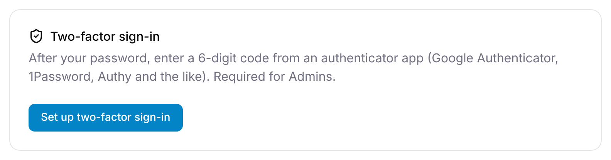

Two-factor sign-in asks for a 6-digit code from an authenticator app (such as Google Authenticator, 1Password or Authy) after your password. Anyone can turn it on. **Admins must use it**, after a grace period.

It's under the avatar menu → **Settings** → **Security**, a tab everyone has.

## Turning it on

1. Select **Set up two-factor sign-in**.
2. Scan the QR code with your authenticator app, or type in the key shown under it.
3. Under **2. Enter the 6-digit code it shows**, type the code from the app and select **Confirm**.

You see "Two-factor sign-in is on", and the card shows **Two-factor sign-in is on** with the date you set it up. **Cancel** stops without turning it on.

## Signing in with a code

After your email and password, GigWrangler shows **Two-factor sign-in**: "Enter the 6-digit code from your authenticator app." Type the code and select **Verify**. Nothing from your organization loads until you do. **Sign out** goes back to the sign-in screen.

If the code is wrong, you see "That code didn't work. Check the time on your phone and try the newest code."

If you sign in with **Continue with Google**, Google's sign-in counts: GigWrangler doesn't ask for a code.

## Turning it off

On the **Security** tab, select **Turn off**. You see "Two-factor sign-in is off". An Admin past the 14 days below is asked to set it up again at the next sign-in.

## Admins must use it

An Admin has 14 days from becoming an Admin to set it up. Until then a banner at the top of every page says "Two-factor sign-in will be required for Admins in {N} days." Select **Set it up** to go to the **Security** tab.

After the 14 days, an Admin who hasn't set it up sees **Set up two-factor sign-in** ("Admins must use two-factor sign-in. Set up an authenticator app to continue.") straight after signing in, and can't use the app until it's done. **Sign out** is the only other way off that screen. Signing in with Google counts here too.

## If you lose your phone

The code screen says "Lost your phone? Ask a platform moderator to reset your two-factor sign-in." A moderator removes your authenticator, so you can sign in with your password alone. Then set it up again with your new phone: an Admin past the 14 days is asked to straight after signing in. See [Platform moderators](/reference/access-requests-and-moderation/#platform-moderators).

## Related

- [Settings & integrations](/settings/overview/)
- [Roles & access](/reference/roles-and-access/)
